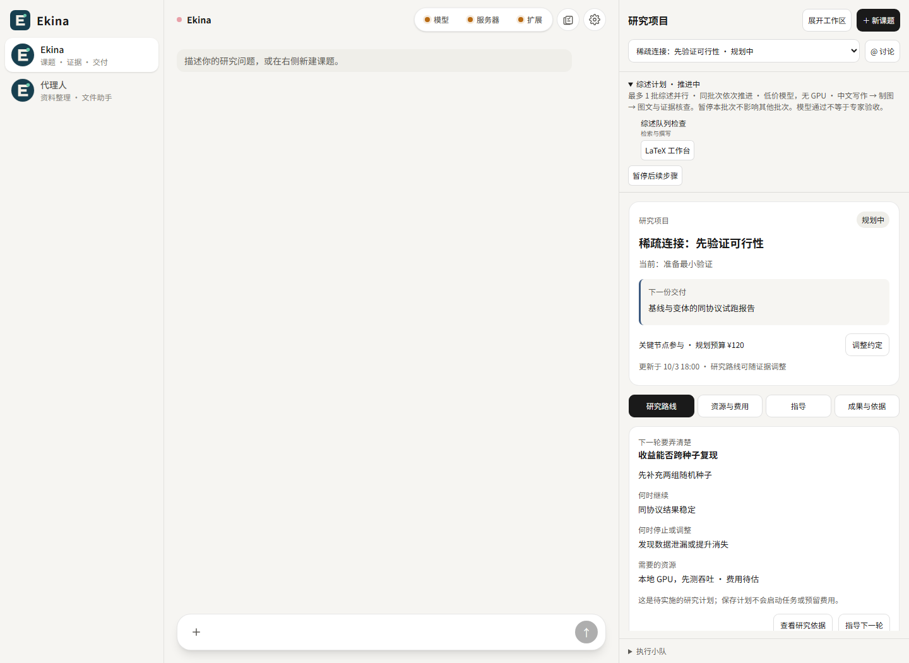

# Ekina

**让研究过程有据可查，让 AI 科研成果可以复核。**

Ekina 是一个本地部署的 AI 科研工作台，把研究问题、文献证据、实验记录、学术写作和交付审查组织在同一条工作流中。

[English](README.en.md) · [安装与配置](docs/GETTING_STARTED.md) · [架构](docs/ARCHITECTURE.md) · [插件](plugins/README.md) · [MCP](mcps/README.md) · [Skills](skills/README.md) · [开源准备](docs/RELEASE.md)

> 当前为源码预览版。核心科研功能来自已有项目，正在做产品化整理；付费模型、远程算力和完整研究流程需要使用者自行配置并验证。项目自有源码采用 [MIT](LICENSE)；第三方依赖保留各自许可。本次公开的是源码预览版。

## 为什么做 Ekina

科研的难点不仅是生成文字。文献是否真的支持结论？实验数字来自哪个配置？下一轮研究为什么值得做？Ekina 将这些问题保留在项目和产物中，帮助研究者检查 AI 的过程与结果。

```text
提出问题 → 组织课题 → 收集与阅读证据 → 综述 / 实验 / 写作 → 审查 → 交付与下一轮研究
                         ↑                       │
                         └────── 补证据与修订 ────┘
```

## 当前能力

| 能力 | 已有实现 | 使用边界 |
| --- | --- | --- |
| 科研项目 | 研究计划、进度板、证据/审查/结论记录、研究检查点 | 结论仍需研究者复核 |
| 文献综述 | 多主题任务、全文导入、来源记录、图文产物和修订 | 全文可用性与版权由来源决定 |
| 论文工作流 | 文献检索、复现尝试、实验任务、LaTeX 和引用检查 | 模板运行、合成数据不等于真实科研成果 |
| 科研协作 | 可配置的执行器、任务状态和产物回读 | OpenCode 等工具需另行安装 |
| 扩展能力 | 后端能力包、MCP 客户端、标准目录 Skills | 能力包目前编译进后端，非热插拔市场 |
| 外部接入 | Ekina Research MCP：查询项目、综述、论文和能力包 | 本次新增，只读；不自动启动付费任务 |

主界面围绕科研会话、项目和证据展开。产品不包含 Live2D、桌宠、角色模型、私人研究库或用户运行记录。



*界面来自隔离测试数据，展示研究路线与证据工作流，不代表已完成的真实研究。*

## 快速开始

需要 Java 21、Maven 3.9+、Node.js 22.12+、Python 3.10+；数据库使用 PostgreSQL 16 与 pgvector。Docker 仅用于下面的数据库启动方式。

```powershell
# 在本 README 所在目录执行
Copy-Item .env.example .env
# 编辑 .env：填写模型服务地址、模型 ID、API key 和数据库密码
docker compose up -d db
npm --prefix ekina-ui ci
npm --prefix ekina-ui run build
python -m pip install -r scripts/requirements-review-documents.txt
mvn package -DskipTests
python scripts/run.py
```

浏览器打开 **http://127.0.0.1:8081/shell/**。Linux/macOS 第一步用 `cp .env.example .env`，Python 命令可用 `python3`。具体环境变量、可选执行器和排错见[安装文档](docs/GETTING_STARTED.md)。前端构建和 Maven 构建不需要真实 API key；研究任务需要。

## 从一个研究问题开始

输入：“整理某一研究方向的近年方法，说明分类依据、比较条件、证据缺口和可验证的下一步。”

1. 明确范围、已有资料和预期交付，建立课题。
2. 阅读来源，保留题录、全文状态和结论依据。
3. 在项目中查看进度、证据和待审查内容。
4. 导出综述或论文产物，对引用、图表、数字与限制做复核。

可直接使用[演示任务](examples/research-brief.md)。这是演示输入，不是已完成研究结果。

## 目录

```text
Ekina/
├── ekina-ui/                Vue 科研界面
├── ekina-bootstrap/         HTTP API、配置与启动入口
├── ekina-application/       课题、综述、论文和任务编排
├── ekina-domain/            领域接口与对象
├── ekina-infrastructure/    模型、数据库、工具和 MCP 客户端
├── ekina-common/            共享代码
├── plugins/                 科研能力包清单与扩展约定
├── mcps/research/           可独立运行的只读 MCP 服务
├── skills/                 可复用的科研 SKILL.md
├── personas/               科研角色指令
├── templates/              论文模板安装说明（第三方模板未捆绑）
├── examples/               可公开的演示输入
├── scripts/                启动、校验和文档处理
└── docs/                   安装、架构、推广与发布说明
```

## 参与建设

优先欢迎：真实研究用例、证据追溯问题、独立环境安装反馈、文献导入适配器、科研 Skills 和可复现的评估任务。提交前阅读 [CONTRIBUTING](CONTRIBUTING.md) 与 [SECURITY](SECURITY.md)。

路线图与发布边界见 [ROADMAP](docs/ROADMAP.md)；中英文产品介绍、演示脚本和推广文案见 [推广资料](docs/PROMOTION.md)。不将“自动发论文”“保证创新”或“无人值守科研”作为当前能力宣传。
